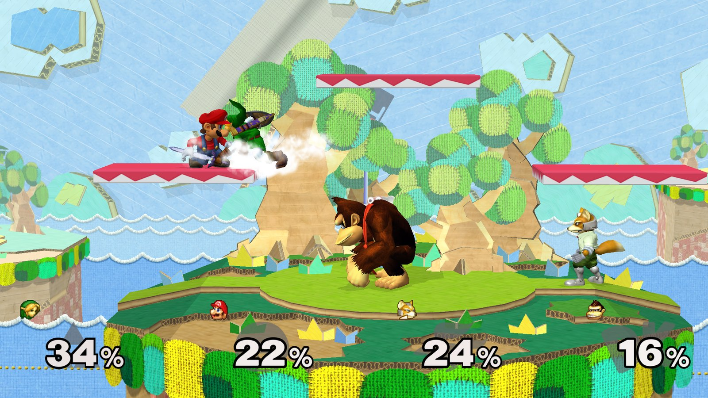
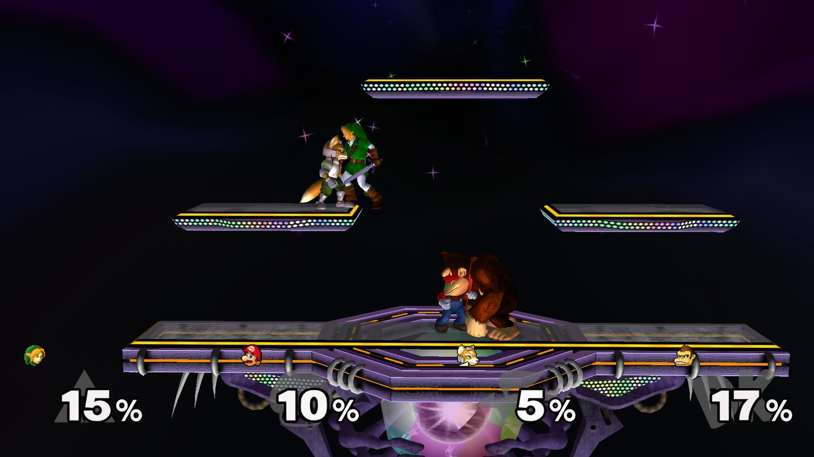
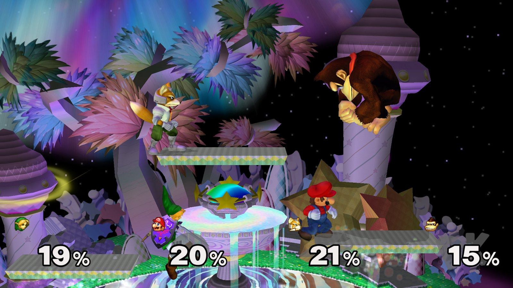
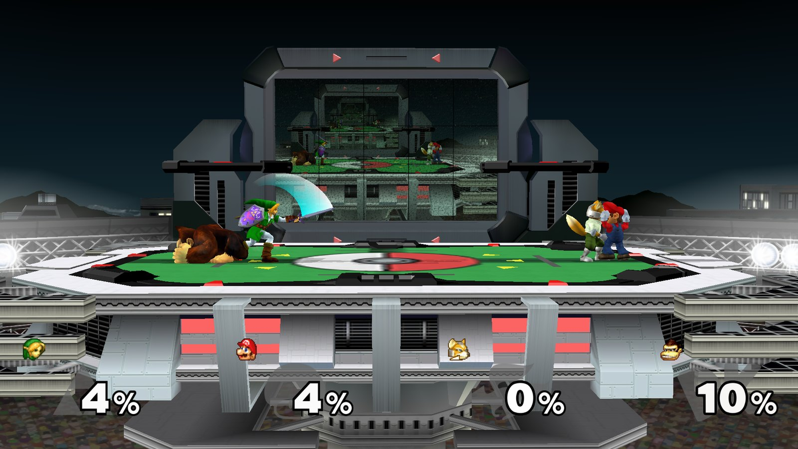
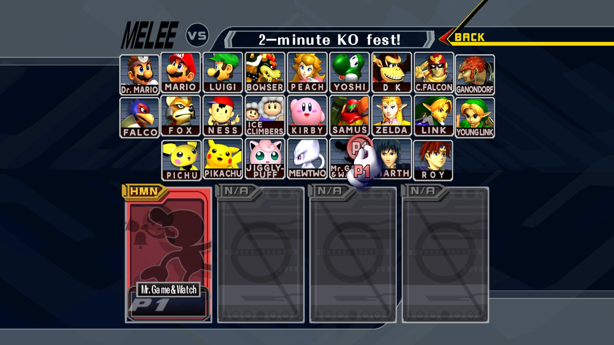
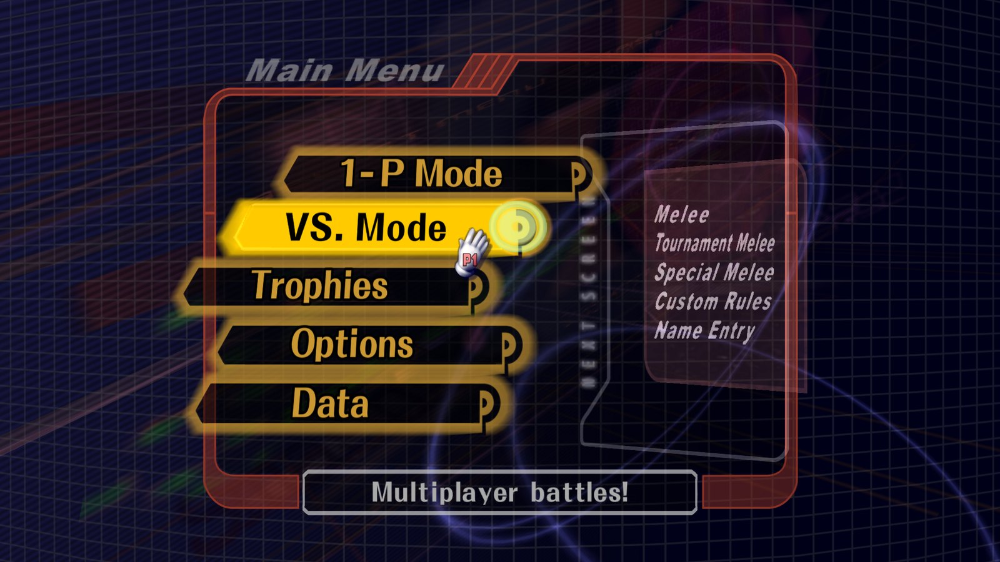
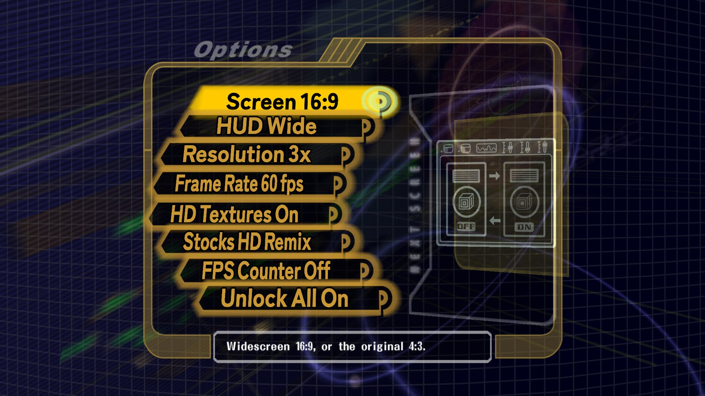

# Melee 4K

Super Smash Bros. Melee on your Mac or Windows PC: 4K, widescreen, HD
textures, and up to 144 fps.

[](docs/media/gameplay.mp4)

**[▶ Watch gameplay](docs/media/gameplay.mp4)**

| | |
|---|---|
|  |  |
|  |  |
|  |  |

## Install

You need your own copy of the game: a disc image of **Super Smash Bros. Melee
(USA, version 1.02)**, as `.iso`, `.gcm`, `.ciso` or `.rvz`. No game data comes
with Melee 4K.

### macOS (Apple Silicon: M1 or newer)

1. Open **Terminal** (Spotlight: type "Terminal"), paste this line and press
   Return:

   ```
   curl -fsSL https://raw.githubusercontent.com/rileycleavenger/melee-4k/v1-pc/install.sh | bash
   ```
2. A Finder window opens: drag your Melee disc image into it.
3. Wait for **Installed**. The first run downloads the HD textures (about
   2.5 GB, a few minutes), then the game starts.

After that, open **Melee 4K** from the Desktop, Launchpad or Spotlight.

### Windows (10 or 11, 64-bit)

1. Download **Melee4K-Windows-x86_64.zip** from the
   [latest release](https://github.com/rileycleavenger/melee-4k/releases/latest),
   right-click it and choose **Extract All**.
2. Drag your Melee disc image into the **PUT-YOUR-ROM-HERE** folder.
3. Double-click **Setup.exe**. If Windows says "Windows protected your PC",
   click **More info**, then **Run anyway**.
4. Wait for **Done**. The first run downloads the HD textures (about 2.5 GB,
   a few minutes), then the game starts.

After that, use the **Melee 4K** shortcut Setup put on your desktop.

### Updating

In the game: **Options > Melee 4K > Check for Updates** (or F1). When a new
version is out, press A again: the game closes, updates itself and opens
again. Your disc, saves, settings and textures are kept. (Or: run the
Terminal line again on macOS; on Windows extract the new release, move your
disc image into its PUT-YOUR-ROM-HERE folder and run Setup.)

---

Controls, online play, settings and troubleshooting: [docs/playing.md](docs/playing.md).
Building, credits and license: [docs/melee-4k.md](docs/melee-4k.md),
[NOTICE.md](NOTICE.md).
